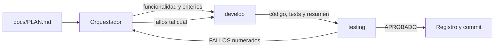

# Mini CRM

CRM sencillo para que un comercial o una pyme gestione sus clientes y sus oportunidades de venta con un embudo por etapas. Cada usuario ve solo sus datos.

[](https://github.com/MarcoAfHz/minicrm/actions/workflows/check.yml)

## Demo

- **URL:** https://minicrm-lovat.vercel.app
- **Usuario de prueba:** `demo@minicrm.app`
- **Contraseña:** (se indica en la entrega)

El usuario de prueba tiene datos de ejemplo (8 clientes y 16 oportunidades) creados con [`supabase/seed.sql`](supabase/seed.sql). Las fechas son relativas al día en que se carga el seed, así que el panel siempre muestra cierres próximos, alguno vencido y ganadas de este mes.

## Qué hace la app

- **Clientes:** listado con buscador por nombre o empresa, alta y edición con validación, borrado con confirmación y ficha con sus oportunidades.
- **Oportunidades:** tablero con una columna por etapa (nuevo, contactado, propuesta, ganada, perdida), con el número y el importe total de cada una. Se crean desde el tablero y se editan o se mueven de etapa desde la propia tarjeta.
- **Panel:** importe en curso, importe ganado este mes, tasa de éxito, número de clientes, los 5 próximos cierres (marcando los vencidos) y un resumen del embudo.
- **Sesión:** login con email y contraseña. Todas las páginas privadas comprueban la sesión en el servidor.
- Pensada también para el móvil (375 px de ancho, sin scroll horizontal).

## Cómo se ha construido: el equipo de agentes

La app la ha programado un equipo de tres agentes de Claude Code con papeles separados. Ninguno se aprueba a sí mismo.

| Agente | Archivo | Qué hace |
|---|---|---|
| Orquestador | [`CLAUDE.md`](CLAUDE.md) | Elige la siguiente funcionalidad de [`docs/PLAN.md`](docs/PLAN.md), se la encarga a `develop`, pasa el resultado a `testing`, devuelve los fallos sin resolverlos él y escribe el registro. No toca el código de la app. |
| `develop` | [`.claude/agents/develop.md`](.claude/agents/develop.md) | Programa la funcionalidad y sus tests siguiendo las directrices. |
| `testing` | [`.claude/agents/testing.md`](.claude/agents/testing.md) | Revisa contra [`docs/DIRECTRICES.md`](docs/DIRECTRICES.md) (D1–D9), ejecuta `npm run check` y prueba casos límite. No puede editar archivos: solo da un veredicto `APROBADO` o `FALLOS` con una lista numerada. |



Cada funcionalidad tiene su registro en [`docs/registro/`](docs/registro/), con lo que encontró `testing` en cada ronda y cómo lo arregló `develop`. Algunos fallos reales que `testing` cazó:

- **Un emoji rompía la validación** ([registro 02](docs/registro/02-clientes.md)): Zod contaba la longitud en unidades UTF-16 y PostgreSQL en caracteres (`char_length`). Un nombre de un solo emoji pasaba el formulario, pero lo rechazaba la base de datos con un error genérico. Ahora las dos capas cuentan igual.
- **"0.500" se guardaba como 500 €** ([registro 03](docs/registro/03-oportunidades.md)): el patrón de miles aceptaba un primer grupo con cero, así que quien quería escribir 0,50 € guardaba mil veces más sin ningún aviso. `testing` lo encontró ejecutando la función con entradas raras, no solo leyendo los tests.
- **"Ganado este mes" podía mentir** ([registro 04](docs/registro/04-panel.md)): se calculaba con `updated_at`, que cambia en cualquier edición. Al editar en noviembre una venta ganada en octubre, pasaba a contar en noviembre. Se añadió la columna `ganada_at`, gestionada por un trigger.
- **La CI fallaba en limpio** ([registro 06](docs/registro/06-integracion-continua.md)): en un checkout limpio, como el de GitHub Actions, TypeScript no encontraba `LayoutProps`, un tipo que genera Next. En local pasaba por los restos de builds anteriores. `testing` lo reprodujo con `git archive` en una carpeta temporal.

## Stack

Next.js 16 (App Router, TypeScript), React 19, Tailwind CSS 4, Supabase (PostgreSQL, Auth y RLS), Zod, Vitest, GitHub Actions y Vercel.

## Decisiones técnicas

- **Datos aislados por usuario con RLS.** Cada tabla tiene `owner_id`, RLS activado y políticas de select, insert, update y delete. Las de oportunidades comprueban además que el cliente sea del mismo usuario (la clave foránea sola no lo impide). Como segunda defensa, todas las consultas filtran también por `owner_id`.
- **Dinero sin errores de coma flotante.** Los importes se guardan como `numeric(12,2)` y se suman en céntimos enteros. En pantalla se formatean en `es-ES` (`1.234,50 €`).
- **Zona horaria Europe/Madrid.** "Ganado este mes" y "vencida" se calculan con el día y el mes de Madrid, también en los cambios de hora.
- **La base de datos guarda la fecha de ganada.** Un trigger rellena `ganada_at` al pasar a "ganada" e ignora lo que envíe el cliente.
- **Server Components y Server Actions.** Las lecturas se hacen en el servidor. Cada acción comprueba el usuario, valida con Zod y devuelve un error en español, sin dejar escapar errores internos.
- **Cache Components de Next 16.** Las lecturas de sesión van dentro de `<Suspense>`. El `proxy` solo refresca la sesión: la protección está en cada página.
- **Lógica pura con tests.** Cálculos del embudo, métricas, formatos y validaciones están en `src/lib/`, con tests de Vitest que incluyen casos límite.

## Arrancar en local

Requisitos: Node.js 22 y un proyecto de [Supabase](https://supabase.com).

```bash
npm install
cp .env.example .env.local
```

Rellena en `.env.local` las dos variables con los datos de tu proyecto de Supabase (Project Settings → API):

- `NEXT_PUBLIC_SUPABASE_URL`
- `NEXT_PUBLIC_SUPABASE_PUBLISHABLE_KEY`

Crea las tablas aplicando las migraciones de `supabase/migrations/`:

```bash
npx supabase login
npx supabase link --project-ref <id-de-tu-proyecto>
npx supabase db push --remote
```

Datos de ejemplo (opcional): crea en Supabase (Authentication → Users) el usuario `demo@minicrm.app` y aplica el seed:

```bash
npx supabase db push --remote --include-seed
```

El seed es idempotente: borra y vuelve a crear solo los datos de ese usuario. Si el archivo no ha cambiado, la CLI puede no volver a aplicarlo; en ese caso, ejecuta `supabase/seed.sql` en el SQL Editor de Supabase.

Arranca la app:

```bash
npm run dev      # http://localhost:3000
npm run check    # lint + tipos + tests + build (lo mismo que la CI)
npm test         # solo los tests
```

## Prueba de punta a punta

Con [Playwright](https://playwright.dev), en `e2e/`. Recorre la app como un usuario: entra, crea un cliente (`E2E Cliente <marca de tiempo>`), le crea una oportunidad de 12.345,67 €, la mueve a «Ganada» en el tablero, comprueba que «Ganado este mes» del panel sube exactamente ese importe y borra el cliente (su oportunidad se borra en cascada). Lo hace dos veces: en escritorio y a 375 px de ancho (proyecto `movil`, con la barra de navegación inferior). También comprueba que, sin sesión, `/panel` lleva a `/login`.

Variables de entorno (nunca se escriben en el código):

- `E2E_BASE_URL`: la URL de la app. Por defecto, `http://localhost:3000`.
- `E2E_EMAIL` y `E2E_PASSWORD`: el usuario con el que se entra. Si faltan, la prueba del flujo se salta y solo se ejecuta la de la sesión.

```bash
npx playwright install chromium   # la primera vez
E2E_BASE_URL=https://minicrm-lovat.vercel.app E2E_EMAIL=... E2E_PASSWORD=... npm run e2e
npm run e2e -- --project=movil    # solo el móvil
```

No deja datos: antes y después de cada prueba borra los clientes que empiecen por `E2E Cliente ` (por si una ejecución anterior falló a mitad). Los dos proyectos usan el mismo usuario y comparan las cifras del panel, así que se ejecutan de uno en uno. No forma parte de `npm run check` ni de la CI, porque necesita un usuario real.

## Seguridad

- No hay claves en el repositorio. La app solo usa la URL del proyecto y la **publishable key** de Supabase, que se leen de variables de entorno. `.env.example` lleva solo los nombres.
- La clave `service_role` no se usa en ningún sitio.
- La publishable key es pública por diseño: lo que protege los datos es RLS en la base de datos, que hace que cada usuario solo pueda leer y modificar sus propias filas.
